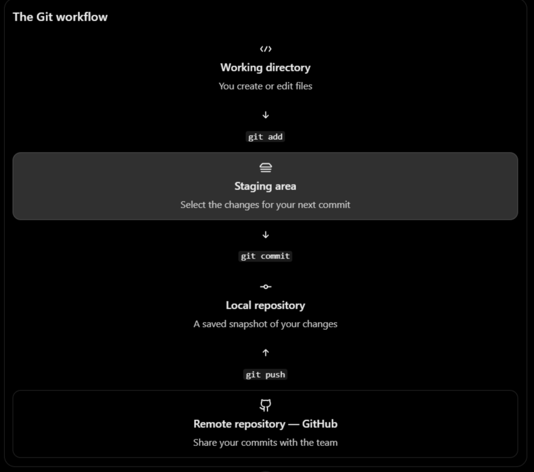

## the first four command :
- git status
- git add .
- git commit -m "chnages"
- git push

## Install and cofigure Git
- git --version

# set author name and email (only one time)
- git config --global user.name "name"
- git config --global user.email "email"

# view global configuration and active configuration
- git config --global --list
- git config --list

### create and download repo:
- mkdir backend-project
- cd backend-project

- git init => initializes
- git status

### clone:
- git clone repo-url
- cd repo

### clone and download repo and its history to your pc
- git clone <url> my-folder => clone into a folder named
- git clone --branch main <url> => check out the specific branch
- git clone --depth 1 <url> => create a shallow clone with limited history

### connect local repo to github:
- git remote -v
- git remote add origin <repo-url>
- git remote set-url origin <new-repo-url>
- git remote show origin

### branches(important):
- git branch
- git branch -a => listd of local and remote tracking branches

- git branch -r => lists remote-tracking branches

- git branch feature/auth 
- git switch feature/auth
- git switch -c feature/auth => create branch + switch to it

- git branch -m feature/auth feature/login => rename the branch
- git branch -d feature/auth => deletes a merged branch, if git considers it safe
- git branch -D feature/auth => force deletes a local branch, even if it isn't merged

### feature branch workflow:
- git switch main 
- git pull --ff-only origin main
- git switch -c feature/user-auth
- git add .
- git commit -m "msg"
- git push -u origin feature/user-auth

